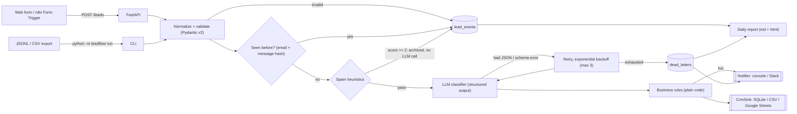

# LeadFlow AI — inbound lead triage automation

A small B2B company gets leads from its website form and its inbox. Every morning someone reads them all, decides which ones deserve a call, copies them into a CRM sheet and writes the first replies. LeadFlow AI automates that loop: it validates and deduplicates incoming leads, drops obvious spam before spending a token, asks an LLM for a **schema-validated** classification (intent, budget, urgency, fit score, language, summary, first reply in the lead's language), applies **deterministic business rules** to decide who owns the lead, writes it to the CRM, pings sales about hot leads, and produces a daily report. Every input ends in exactly one recorded state (processed, duplicate, invalid, spam-filtered or dead-lettered), so no lead is lost without a trace.

> This is a portfolio demo. All leads in `data/` are fictional (`.example` domains), and the numbers below come from the offline demo, not from a client deployment.

## Architecture



```
src/leadflow/
  models.py       domain models + the Classification contract
  normalize.py    HTML stripping, phone normalization (+57), dedupe key, spam heuristics
  classifier.py   prompt, JSON schema, validation, retry/backoff
  rules.py        deterministic tiering and routing
  pipeline.py     the use case: one lead in, one LeadOutcome out
  store.py        SQLite: idempotency keys, event log, dead-letter queue
  sinks.py        CrmSink port: SQLiteCrmSink, CsvExportSink, GoogleSheetsSink
  notify.py       Notifier port: ConsoleNotifier, SlackWebhookNotifier
  llm/            LLMProvider port: AnthropicProvider, OpenAIProvider, FakeProvider
  api.py, __main__.py, report.py, ingest.py
```

## Design decisions

- **Structured output, validated on our side.** The `Classification` Pydantic model is the contract. Its JSON schema is sent to the provider (forced tool call for Anthropic, `json_schema` response format for OpenAI), but the provider only returns text: one function validates it for every provider. Enums, the 0–100 range and `extra="forbid"` are enforced, so a malformed response cannot reach the CRM.
- **Retries that learn, then a dead-letter queue.** On invalid JSON, schema errors or API errors the classifier waits `base * 2^n` and retries up to 3 times, feeding the validator's error back to the model. After that the lead goes to the `dead_letters` table with the full payload and every error, and a notification is sent. The idempotency claim is released, so resubmitting the lead retries it instead of dropping it as a duplicate.
- **Guardrails after the model.** The LLM proposes and `rules.py` decides. `hot` requires `quote_request` and `fit_score >= 70` (configurable). A stated budget under 1k or low urgency caps the lead at `warm`. Spam is archived and never written to the CRM, job applications go to HR and support requests go to support. Sales can read and change these rules without touching a prompt.
- **Idempotency and dedupe.** The dedupe key is `sha256(lowercased email + normalized message)`. It is claimed atomically (`INSERT OR IGNORE` on a primary key) before any model call, so retries from n8n, double form submits and re-imported files cost nothing.
- **Cheap filters first.** Validation (email, minimum message length), HTML stripping, phone normalization to E.164 (Colombian mobiles `3xx` and landlines `60x`) and precision-tuned spam heuristics all run before the LLM. Ambiguous spam is left for the model to judge.
- **Ports and adapters.** `LLMProvider`, `CrmSink` and `Notifier` are `Protocol`s. The pipeline only depends on those, which is why the whole thing runs offline with `FakeProvider` + SQLite + console, and why swapping in HubSpot or Teams would be one new adapter.
- **Real LLMs are opt-in.** Having an API key in the environment does not switch providers; `LLM_PROVIDER` must be set explicitly, so a demo can never turn into billable traffic by accident.

## How to run

Requires Python 3.11+.

**Offline demo (no keys, no network), one command:**

```bash
make install && make demo     # processes data/sample_leads.jsonl, then writes out/report.md + out/report.html
```

`make demo` uses the deterministic `FakeProvider` with **fault injection** (`FAKE_FAILURE_RATE=0.35`, `FAKE_SEED=7`, 50 ms backoff base). That deliberately high failure rate is there so the retry and dead-letter paths show up in the output.

**API:**

```bash
make run                      # uvicorn on :8000, docs at http://localhost:8000/docs
curl -X POST localhost:8000/leads -H 'content-type: application/json' \
  -d '{"name":"Ana","email":"ana@acme.example","company":"Acme","message":"We need a quote to automate our CRM intake, budget USD 10k"}'
```

`POST /leads` returns 200 for processed, duplicate or spam-filtered leads, 422 for invalid ones and 202 for dead-lettered ones. `POST /leads/batch` accepts up to 500 leads.

**With a real LLM:**

```bash
pip install -e ".[anthropic]"   # or .[openai]
export LLM_PROVIDER=anthropic ANTHROPIC_API_KEY=... LLM_MODEL=claude-sonnet-4-5
python -m leadflow run --input data/sample_leads.jsonl --fresh
```

Optional adapters: `CRM_SINK=csv` or `CRM_SINK=sheets` (needs `GOOGLE_SERVICE_ACCOUNT_FILE` and `GOOGLE_SHEET_ID`, plus `pip install -e ".[sheets]"`), and `SLACK_WEBHOOK_URL` for Slack. See `.env.example`.

**With n8n:** `docker compose up` starts the API and n8n. Import `n8n/leadflow-workflow.json` into n8n. The flow is Form Trigger → HTTP Request to `http://leadflow:8000/leads` → IF `tier == "hot"` → Google Sheets append + Slack message, else → Google Sheets append. Set your Sheet ID and attach Google Sheets and Slack credentials (they are placeholders in the JSON).

## Sample run

The numbers below were measured with the **offline demo using the deterministic FakeProvider** on the 40 fictional leads in `data/sample_leads.jsonl`. I ran `make demo` on Python 3.13 on a Linux container. Counts are deterministic; timings vary from machine to machine.

| Metric | Value |
|---|---|
| Inputs received | 40 |
| Rejected at validation (3 malformed emails, 1 too-short message) | 4 |
| Duplicates removed before the model | 4 |
| Spam filtered before the model (no LLM call) | 4 |
| Classified by the model | 27 |
| Dead letters (after 4 attempts each) | 1 |
| LLM calls, including retries | 40 |
| Hot leads (sales notified) | 6 |
| Other tiers | warm 9, cold 3, routed to HR or support 8, archived 5 |
| Total processing time | 1.001 s |
| Average per input (CLI) | 25.02 ms |
| Average per lead (daily report) | 23.7 ms (21.6 ms for classified leads only) |

Most of that time is the deliberate backoff sleeps from fault injection. The same file with `FAKE_FAILURE_RATE=0` processed 28 leads with 28 LLM calls and 0 dead letters in **0.110 s (2.76 ms per input)**. That is pipeline overhead only. With a real LLM, per-lead time is dominated by model latency, which this demo does not measure.

## Tests

```bash
make test     # 45 passed
make lint     # ruff check + ruff format --check + mypy --strict
```

The tests cover validation and phone normalization, the HTML stripper, dedupe (within and across runs), the spam pre-filter (asserting zero model calls), routing rules, retry with exponential backoff, the dead-letter path (including resubmission after a DLQ), seeded fault injection, the CSV sink, both API endpoints via `TestClient`, report generation and the structure of the n8n workflow. No test touches the network.

## Limitations

- `FakeProvider` is keyword heuristics, not a model. It makes the pipeline runnable and testable, but it says nothing about how accurately a real LLM classifies leads. That has to be measured on labelled data from real traffic.
- The Anthropic, OpenAI, Google Sheets and Slack adapters are written against their SDKs/APIs but are not exercised here (no credentials, by design).
- SQLite is fine for one instance. Several workers would need Postgres for the store and a real queue for the DLQ.

## Resumen en español

LeadFlow AI automatiza la clasificación de leads entrantes de una empresa B2B pequeña. Recibe leads por webhook (FastAPI), CSV o JSONL. Valida y normaliza los datos (correo, teléfonos colombianos +57, HTML), elimina duplicados y descarta el spam evidente antes de llamar al modelo. Luego usa un LLM con **salida estructurada validada** (intención, presupuesto, urgencia, puntaje de encaje, idioma, resumen y primera respuesta en el idioma del lead). Si la respuesta es inválida, reintenta con backoff exponencial, y si se agotan los intentos el lead pasa a una cola de mensajes muertos (dead-letter) en SQLite: nada falla en silencio. Reglas de negocio deterministas deciden si el lead es "hot", va a RR. HH. o se archiva. El resultado se guarda en un CRM intercambiable (SQLite, CSV o Google Sheets), se avisa por consola o Slack y se genera un reporte diario. Incluye un flujo de n8n importable, Docker y 45 pruebas automatizadas. Las cifras del README provienen de la demo offline con un proveedor simulado y determinista. No corresponden a un cliente real.
